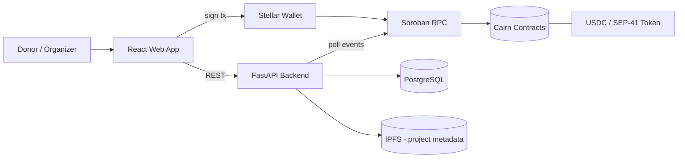

<div align="center">

# 🪨 Cairn

**Quadratic funding for the Stellar ecosystem.**
Many small voices, matched fairly, settled on-chain.

[](https://stellar.org)
[](https://soroban.stellar.org)
[](https://fastapi.tiangolo.com)
[](https://react.dev)
[](LICENSE)
[](CONTRIBUTING.md)

</div>

---

## What is Cairn?

A cairn is a stack of stones where every traveller adds one. **Cairn** is an
open-source platform for running **quadratic funding (QF) rounds** on Stellar.

In a QF round, a matching pool (from a foundation, DAO, or sponsor) tops up
donations to projects. The match is **not proportional to money raised, but to
the number of unique people who gave**. Fifty people giving 1 USDC each attract
far more matching than one whale giving 50 USDC.

Cairn runs the whole round on Soroban, so the formula, the pool, and the payouts
are transparent and verifiable by anyone.

## Why Stellar?

- **Near-zero fees** make 1 USDC donations economically viable.
- **USDC and local anchors** let contributors in emerging markets participate.
- **Soroban** is deterministic and cheap enough to compute matching on-chain.
- Strong public-goods culture (SCF, Drips Wave) that needs fair allocation tools.

## How matching works

For each project `p`, with donors `i` and each donor's total contribution `c_i`:

```
match(p) ∝ ( Σ √c_i )²  −  Σ c_i
```

Matching is then normalised so the sum of all project matches equals the pool.
The contract keeps a running `Σ √c_i` per project, so finalising a round is
cheap and needs no trusted off-chain calculation.

## Features

- 🏛️ **Round factory**: anyone can create a round with a token, a matching pool, start/end times and a donor cap.
- 📝 **Project registry**: projects apply, organizers approve, metadata is stored as an IPFS CID.
- 💸 **Donations in USDC or any SEP-41 token**, with per-donor caps.
- 🧮 **On-chain QF settlement** using fixed-point integer square roots.
- 🛡️ **Sybil resistance**: pluggable attester allowlist; contributions from attested wallets can be weighted higher.
- 🔍 **Live match estimator** in the UI: see how your donation moves the match before you sign.
- 📊 **Public leaderboards and round analytics** served by the indexer API.
- 🔐 **SEP-10 wallet auth** and Freighter / xBull / Albedo support.
- 🧪 **Simulation mode** for organizers to test rules against historical data.

## Architecture



## Repository layout

```
cairn/
├── contracts/               # Rust / Soroban workspace
│   ├── round-factory/       # Deploys and tracks rounds
│   ├── round/               # Donations, matching, settlement
│   ├── project-registry/    # Project applications and approvals
│   └── attester-registry/   # Sybil-resistance attestations
├── backend/                 # FastAPI service
│   ├── app/
│   │   ├── api/             # Routers: rounds, projects, donations, auth
│   │   ├── indexer/         # Soroban event ingestion
│   │   ├── services/        # Matching simulator, sybil scoring
│   │   └── models/          # SQLAlchemy + Pydantic schemas
│   └── tests/
├── frontend/                # React + Vite + TypeScript
│   └── src/
│       ├── pages/           # Explore, Round, Project, Dashboard
│       ├── components/
│       └── hooks/           # useWallet, useRound, useMatchEstimate
├── docs/                    # Design notes, formula, threat model
├── docker-compose.yml
└── README.md
```

## Smart contract interface (summary)

```rust
// round
fn init(env, admin, token, matching_pool, start, end, per_donor_cap);
fn add_project(env, project_id);                 // admin only
fn donate(env, donor, project_id, amount);       // updates Σ√c_i incrementally
fn finalize(env);                                // computes matches, locks round
fn claim(env, project_id);                       // owner withdraws donations + match
fn estimate_match(env, project_id) -> i128;      // read-only, used by the UI
```

## Backend API (summary)

| Method | Endpoint                          | Description                          |
| ------ | --------------------------------- | ------------------------------------ |
| POST   | `/auth/challenge`, `/auth/verify` | SEP-10 wallet login                  |
| GET    | `/rounds`                         | List rounds with status              |
| GET    | `/rounds/{id}`                    | Round details, pool, totals          |
| GET    | `/rounds/{id}/projects`           | Projects ranked by current match     |
| GET    | `/projects/{id}`                  | Project details and donor count      |
| POST   | `/rounds/{id}/simulate`           | What-if matching with custom rules   |
| GET    | `/donors/{address}/history`       | A wallet's donation history          |

Interactive docs are served at `http://localhost:8000/docs`.

## Quick start

**Prerequisites:** Rust + `stellar-cli`, Python 3.11+, Node 20+, Docker.

```bash
# 1. Clone
git clone https://github.com/cairn-collective/cairn.git && cd cairn

# 2. Build and test contracts
cd contracts && cargo test && stellar contract build && cd ..

# 3. Deploy to testnet
stellar keys generate deployer --network testnet --fund
./scripts/deploy-testnet.sh

# 4. Start the backend
cd backend
python3 -m venv .venv
source .venv/bin/activate
pip install -r requirements.txt
uvicorn app.main:app --reload

# 5. Start frontend
cd ../frontend && npm install && npm run dev
```

## Roadmap

- [x] Round contract with on-chain QF settlement
- [ ] Project registry and applications
- [ ] FastAPI indexer and REST API
- [ ] React donor and organizer experience
- [ ] Attester registry for sybil resistance
- [ ] Passkey wallet support
- [ ] Retroactive public goods funding rounds
- [ ] Multi-token matching pools
- [ ] Round templates and analytics exports

## Contributing

Cairn is built for the community and every stone counts. Check the
[`good first issue`](../../labels/good%20first%20issue) label, read
[CONTRIBUTING.md](CONTRIBUTING.md), and join the discussion in
[GitHub Discussions](../../discussions). Contracts, API, UI, docs and design
contributions are all welcome.

## Security

Contracts are **unaudited** and for testnet use only. Please report
vulnerabilities privately via [SECURITY.md](SECURITY.md).

## License

Released under the [MIT License](LICENSE).

<div align="center">
<sub>Add a stone. Build the cairn. 🪨</sub>
</div>
